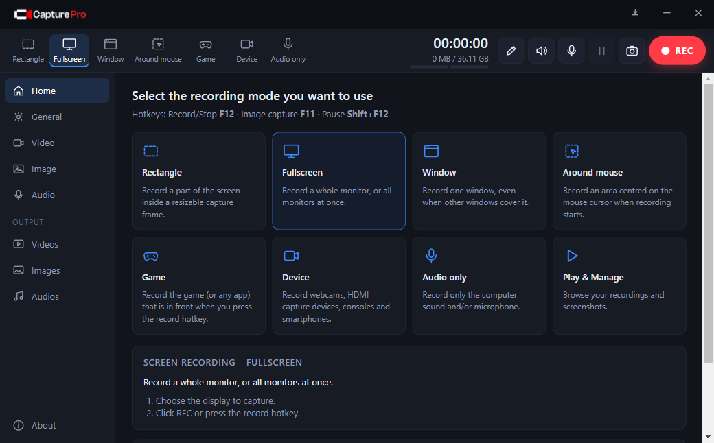
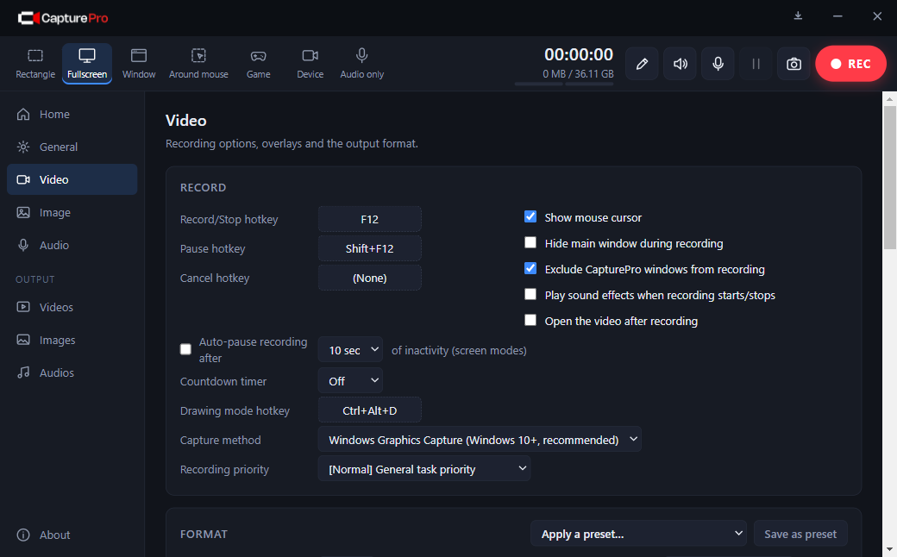
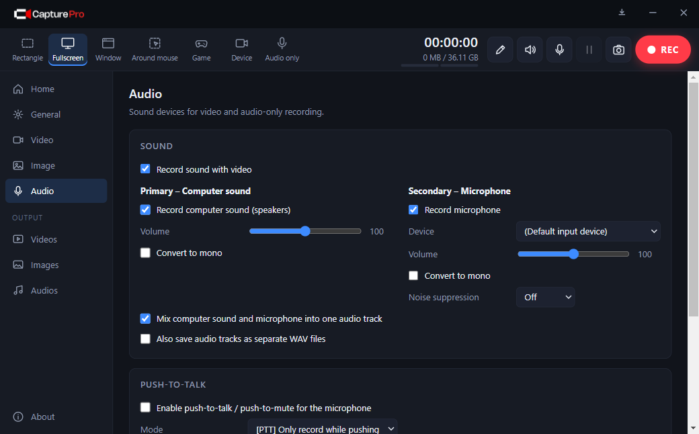
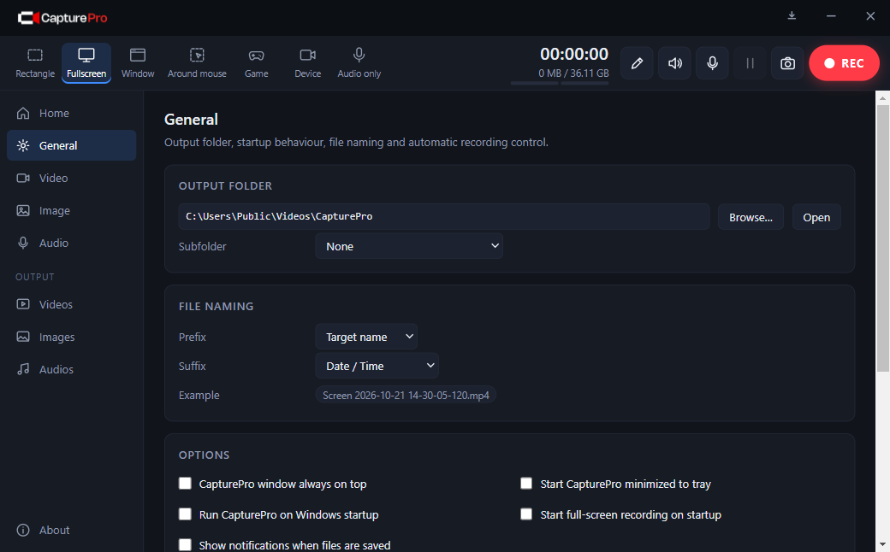
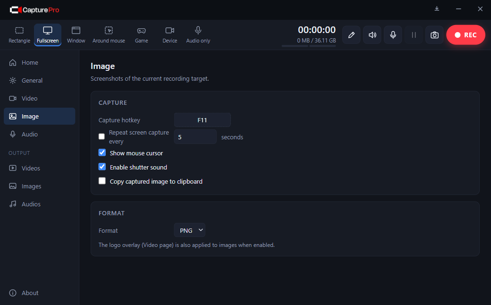
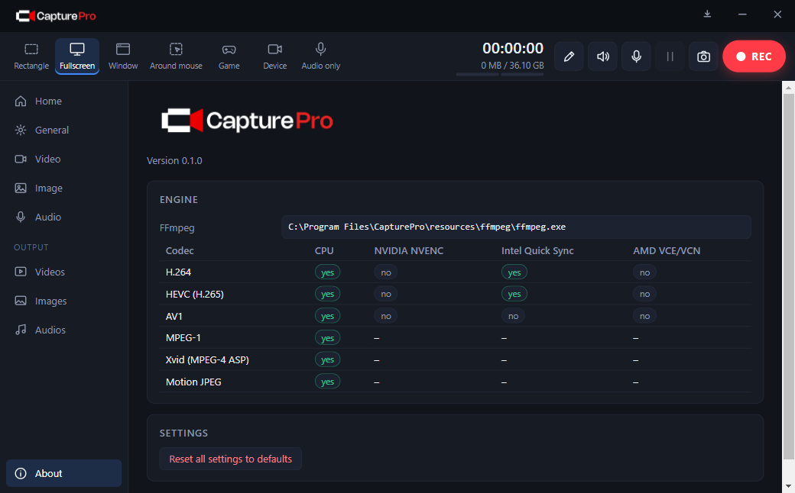

<p align="center">
  
</p>

<p align="center">
  <b>A fast screen, game, webcam and audio recorder for Windows and macOS.</b><br>
  Built with Electron and FFmpeg. Hardware encoding on NVIDIA, Intel, AMD and Apple GPUs.
</p>

<p align="center">
  
  
  
  
</p>

<p align="center">
  
</p>

---

## Contents
- [Features](#features)
- [Screenshots](#screenshots)
- [Requirements](#requirements)
- [Getting started](#getting-started)
- [Default hotkeys](#default-hotkeys)
- [Testing](#testing)
- [Building installers](#building-installers)
- [macOS](#macos)
- [How it works](#how-it-works)
- [Project structure](#project-structure)
- [Roadmap](#roadmap)
- [License](#license)

## Features

**Recording modes**
- **Rectangle**: record part of the screen inside a resizable capture frame.
- **Fullscreen**: record one monitor, or all monitors at once.
- **Window**: record one window, even while other windows cover it.
- **Around mouse**: record an area that follows the cursor.
- **Game**: record the game (or any app) that is in front when you press the hotkey.
- **Device**: record webcams, HDMI capture cards, consoles and phones.
- **Audio only**: record computer sound and/or the microphone.

**Video and encoding**
- Encoders are detected at startup: NVIDIA NVENC, Intel Quick Sync, AMD VCE/VCN, Apple VideoToolbox, or the CPU.
- H.264, HEVC (H.265), AV1, MPEG-1, Xvid and Motion JPEG, saved as MP4, AVI or MKV.
- Format presets, frame-rate and quality control.
- Pause and resume. Recordings are written as crash-safe segments and joined when you stop.
- CapturePro's own windows can be left out of the recording.

**Overlays**
- Webcam overlay with 21 shapes, flip and rotate, borders and chroma key (green screen). It can also be saved as a separate `.webcam.mp4`.
- Mouse click effects and cursor highlight.
- On-screen keystrokes.
- Drawing mode, so you can annotate the screen while you record.
- Countdown timer, logo overlay and text overlay.

**Audio**
- Computer sound and microphone on separate volume controls, mixed into one track or kept apart.
- Mono conversion, noise suppression and push-to-talk / push-to-mute.
- Optional separate WAV file for each audio track.

**Automation**
- Auto-complete a recording by time, file size or silence, then run an action afterwards.
- Scheduled recordings, a recording timer, and auto-pause when there is no activity.
- Start minimized to the tray, start with Windows, or start recording at launch.

**Screenshots and library**
- Image capture (PNG/JPG) with an optional repeat interval and copy-to-clipboard.
- Built-in Videos, Images and Audios library to browse and manage what you recorded.

## Screenshots

| Video settings | Audio settings |
|---|---|
|  |  |
| **General settings** | **Image capture** |
|  |  |

<p align="center">
  <br>
  <sub>The About page shows which hardware encoders CapturePro found on this PC.</sub>
</p>

## Requirements
- **Windows 10 2004 or later** (Windows 11 recommended), or **macOS 11 or later**
- **Node.js 20 or later**
- **FFmpeg 8 or later** on `PATH`. On Windows: `winget install Gyan.FFmpeg`. Capture uses its `gfxcapture`, `ddagrab` and `zmq` filters.
- **Windows:** the .NET Framework 4.x C# compiler that ships with Windows (it builds `native/CaptureProHelper.exe`)
- **macOS:** Xcode command-line tools (`xcode-select --install`)

## Getting started
```bash
git clone https://github.com/ZarrarZia/Capture-Pro.git
cd Capture-Pro
npm install
npm start
```
`npm start` builds the native helper if it's missing, then launches the app with a clean Electron environment.

## Default hotkeys
| Action | Key |
|---|---|
| Record / Stop | <kbd>F12</kbd> |
| Pause / Resume | <kbd>Shift</kbd>+<kbd>F12</kbd> |
| Capture image | <kbd>F11</kbd> |
| Drawing mode | <kbd>Ctrl</kbd>+<kbd>Alt</kbd>+<kbd>D</kbd> |
| Show/hide capture frame | <kbd>Ctrl</kbd>+<kbd>Alt</kbd>+<kbd>H</kbd> |

You can change all of them in the settings.

## Testing
```bash
npm test          # unit tests (codec/argument builders, naming, scheduler, device transcode) + a real capture integration test
npm run test:e2e  # drives the real UI with Playwright, using a fake camera and microphone
```
The E2E tests record your screen for a few seconds and send harmless input: a click on CapturePro's own title bar and the F13 key.

## Building installers

### Windows
```bash
npm run dist
```
This produces two files in `dist/`:
- `CapturePro-Setup-<version>.exe`: an installer with Start-menu and desktop shortcuts and a choice of install folder.
- `CapturePro-Portable-<version>.exe`: runs without installing.

Both include FFmpeg and the native helper, so the target PC doesn't need anything else installed.

> The builds are not code-signed, so Windows SmartScreen shows "Windows protected your PC" the first time you run them (**More info → Run anyway**). Signing with a code-signing certificate removes that warning.

### macOS
```bash
npm ci && npm run dist:mac
```

## macOS
CapturePro runs on macOS 11 or later, on both Apple-silicon and Intel Macs.

**Download:** every push to `main` builds the Mac version with GitHub Actions (**Actions → Build macOS →** artifact **CapturePro-macOS**). Pushing a tag such as `v0.1.0` also publishes the files as a GitHub Release.
- `CapturePro-<version>-mac-arm64.dmg`: Apple-silicon Macs (M1–M4)
- `CapturePro-<version>-mac-x64.dmg`: Intel Macs

**Install:** open the `.dmg` and drag CapturePro into Applications. Apple hasn't notarized the app, so macOS blocks the first launch. Open **System Settings → Privacy & Security** and click **Open Anyway**. On older macOS, right-click the app and choose **Open**.

**Permissions** (macOS asks for them the first time they're needed; restart CapturePro after you grant them):
| Permission | Needed for |
|---|---|
| Screen Recording | recording the screen, window titles |
| Microphone / Camera | microphone, webcam overlay, device recording |
| Input Monitoring | hotkeys, click effects, keystroke overlay |

**Recording computer sound:** macOS doesn't let apps capture system audio directly. Install the free [BlackHole 2ch](https://github.com/ExistentialAudio/BlackHole) (`brew install blackhole-2ch`). Then open Audio MIDI Setup, create a **Multi-Output Device** that contains your speakers and BlackHole, and select it as the sound output. CapturePro records from BlackHole automatically.

**Differences from Windows:**
- Window and Game modes record the area of the screen where the window is, so keep the window in front.
- "All displays" records only the main display.
- Hardware encoding uses Apple VideoToolbox (H.264 and HEVC).

## How it works

```
mode + settings ──► capture-args.js ──► ffmpeg (segment N, .mkv)
                                          ▲ video: ddagrab | gfxcapture | dshow
                                          ▲ audio: \\.\pipe\capturepro-<id>-a{1,2}  (f32le 48 kHz stereo)
                                          ▲ filters: crop/scale, logo overlay, drawtext
pause  = gracefully end segment ('q' on stdin)        resume = start segment N+1
stop   = concat segments (-c copy) ──► final .mp4/.avi/.mkv  (+ separate .1.wav/.2.wav if enabled)
```

- **UI:** the Electron main process plus an HTML/CSS renderer.
- **Capture and encoding:** an `ffmpeg` child process driven by `src/main/recorder.js`. It uses `ddagrab` (Desktop Duplication) or `gfxcapture` (Windows Graphics Capture) on Windows, and AVFoundation on macOS.
- **Audio:** a hidden audio-engine window captures system loopback and the microphone through a WebAudio graph, then streams PCM to FFmpeg over named pipes.
- **Global input:** a small native helper (`native/CaptureProHelper.cs` on Windows, `native/mac/CaptureProHelper.swift` on macOS) provides low-level hotkeys and mouse and keyboard events for the overlays.
- **Overlays:** click effects, keystrokes, drawing and the webcam are transparent, click-through, always-on-top windows, so the screen capture records them. The logo and text are burned in with FFmpeg filters.

See [docs/02-capturepro-architecture.md](docs/02-capturepro-architecture.md) for the full architecture.

## Project structure
```
src/
  main/          Electron main process: recorder, FFmpeg arguments, codecs, scheduler, settings, overlays
  preload/       Context-isolated bridge between the renderer and the main process
  renderer/
    main/        Main window UI
    rect/        Resizable capture frame
    overlay/     Click effects, keystrokes, countdown
    drawbar/     Drawing-mode toolbar
    webcam/      Webcam overlay (shapes, chroma key)
    audio/       Hidden audio engine (loopback + microphone, PCM worklet)
    device/      Device-recording preview
native/          Native input/hotkey helper (C# for Windows, Swift for macOS)
scripts/         Build helpers: native helper, FFmpeg bundling, DMG packaging
test/            Unit, integration and Playwright end-to-end tests
assets/          Icons and logos
docs/            Architecture notes and screenshots
```

## Roadmap
| Phase | Scope | Status |
|---|---|---|
| 1. Core recorder | Recording modes, encoder auto-detection, codecs and containers, presets, pause/resume, hotkeys, tray, library, screenshots, file naming | ✅ Done |
| 2. Overlays | Webcam overlay, click effects, highlight, keystrokes, drawing mode, countdown, logo, text | ✅ Done |
| 3. Automation | Auto-complete, timer, scheduled recording, auto-pause, push-to-talk, startup options, device recording, around-mouse following | ✅ Done |
| 4. Player, editor, AI | Built-in player, trim/export, repair tool, whisper.cpp transcription, AI webcam background removal | 🔜 Next |
| 5. Sharing | YouTube / Vimeo / Drive upload, translations | 📋 Planned |

## License
CapturePro is released under the [MIT License](LICENSE).

The bundled FFmpeg is GPL-licensed; its license ships in `resources/ffmpeg/LICENSE.txt` in the built app.
